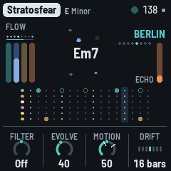

# BERLIN

BERLIN (a working name) turns the M-VAVE FM-1 into a generative Berlin School machine, after the 1970s
music of Tangerine Dream, Klaus Schulze and Ashra: long, hypnotic pieces built on repeating synthesizer
sequences, slowly evolving textures and a lot of space. It plays itself from the moment it's switched on.
A sequence of plucked notes runs over a drone, its notes repeated by the echo; a second sequence, often a
step shorter, drifts against it; a lead sings long phrases far back in the reverb; wind, surf or the sounds
of space pass behind. Each piece emerges from the drone, flows, gives the lead its turn, drifts, ends and
begins again. You don't play it, you steer it: pick a piece and a key, thin or fill the sequences, open the
filter, push the echo, mute and solo the layers, or play the lead yourself on the white keys.

BERLIN is a fork of DUB-1, itself a fork of AMB-1, Charles Vestal's generative ambient firmware for the FM-1.

**This is 0.1, in development.** It runs in the browser emulator and the host simulator; it has not yet been
built for or run on an FM-1.

, running BERLIN, each control labelled")

---

## Contents

1. Install
2. Getting started
3. Controls
4. The screen
5. The layers
6. The arc
7. The pieces
8. The pages
9. The effects grid
10. PERFORM
11. MIDI
12. Saving
13. Troubleshooting
14. Credits

---

## 1. Install

**Try it first in the emulator.** It is the same code the FM-1 runs, with sound, in a browser. Build it
with `web/emu/build.sh`, serve `build/emu` (for example `python3 -m http.server --directory build/emu`) and
open the page. [EMULATOR.md](../EMULATOR.md) has the details.

**On the FM-1** (once there is a device build): `./build.sh` makes `build/amb.fwsc`; install it with

```
python3 tools/fm1_install.py build/amb.fwsc
```

(Python 3 with `pip3 install mido python-rtmidi`, the FM-1 connected by a USB data cable and switched on.)
Don't unplug it while it's writing; when it finishes, the FM-1 restarts into BERLIN. M-VAVE's own
updater, M-UPGRADE, puts the stock firmware back.

> Installing other firmware is at your own risk. If the FM-1 ever won't start, see
> [Recovering an FM-1 that won't start](#recovering-an-fm-1-that-wont-start).

---

## 2. Getting started

BERLIN starts playing as soon as it's on. A few minutes with it:

1. **Listen.** The first piece, Timewind (D minor, 96), begins with only its drone, an organ through a
   phaser, and the wind. Its sequence fades in through a closed filter over the first two minutes or so.
   Then the sequence runs, its notes repeated by the echo, and later the lead comes in. Turn MASTER for the
   volume.
2. **Try another piece.** Turn PRESETS. Each of the eight has its own key, tempo, voices, sequences and
   arc. Stratosfear starts at once with both sequences; Wahnfried and Cyborg have no sequence at all.
3. **Play the lead.** Press a white key: the lead plays that step of the scale, from the root up, and its
   key lights while it sounds. It glides from note to note, deep in the reverb and the echo.
4. **Shape the sequence.** Press ARP: the Sequence page. KNOB 1 (Density) thins it out or fills it in;
   KNOB 3 (Length) makes it shorter or longer. Press ARP again for its sound (Cutoff opens the filter), and
   again for its **Repeats**: the notes the echo plays back, as loud as the note itself.
5. **Hold the echo.** Tap REC: the echo stops listening and repeats what it holds while the music goes
   on dry above it. Tap REC again to let it go. Hold REC: the effects grid, sixteen effects on the white
   keys, each one there while its key is held.
6. **Perform.** Tap SEL: white keys 1–5 mute the five layers, black keys 1–5 solo them, and white keys
   7–11, held, sweep the sequence, open or shut the filter, drop both sequences out or push the echo.
7. **Rest.** Press PLAY: the music stops and the echo and reverb ring away. PLAY again and the piece starts
   from the top of its arc.

What you change is kept with the piece. BERLIN saves it by itself while resting; or hold GLO for half a
second.

---

## 3. Controls

| Control | What it does |
|---|---|
| MASTER | The volume |
| SELECT | The previous or next page, in the panel's order. With HOME held: the tempo |
| PRESETS | The piece (eight) |
| ALGORITHM | On a layer's page, its voice (on the Atmosphere's pages, its character). On the Chords page, the chord walk's character (Home, Wander, Free) |
| OCT− / OCT+ | On a layer's page, its level, 5 a press (held: on). Both together, a quick press: the layer muted, or back (its level kept). Both held 5 s: the update mode |
| KNOB 1–4 | The four values at the bottom of the page. The line above them says what the one turning does |
| White keys | Play the Lead in the piece's scale: the first white key is the root, the next the scale's second step, and so on up. While the Lead sounds a note, that key is lit. On the Pattern page they write the steps instead; in PERFORM they mute and play moves; with REC held they're the effects |
| Black keys | Nothing (in PERFORM, the solos) |
| PLAY | Play / rest |
| REC | A tap: hold (the echo and the cloud repeat what they hold). Held: the effects grid |
| EDIT | A tap: the Chords page. Held: the next chord, on the next bar. Held on (1.5 s): new chords |
| SEL | A tap: PERFORM. Held: **Lock** (the sequences stop varying, each pass as the last, until SEL is held again; not saved) |
| HOME | The Berlin page; again, the Key page |
| ENV | The Drone; again, its sound page |
| ARP | The Sequence; again, its sound page; again, its Repeats |
| LFO | The Lead; again, its sound page |
| SEQ | Sequence 2; again, its sound page; again, the Pattern page |
| SAVE | The Atmosphere; again, its sound page |
| FX | The Space page; again, the Echo page |
| GLO | The Setup page; again, the Arc page. Held half a second: save. Held on (1.5 s): the piece back to its recipe |

**Nudges.** Hold a layer's button (ENV, ARP, LFO, SEQ) for half a second: its sound takes a small step
somewhere new (its filter, envelope, tone or vibrato, never its sends or octave). Hold it on for 1.5 s: a
shake, a new voice and bigger steps. HOME held on shakes every layer at once. Each step is pulled back
towards the piece's recipe, so nudges explore around the piece's sound rather than wander off. With Evolve
over 40, BERLIN nudges a layer by itself now and then.

A long press says what it did on a card in the middle of the screen.

---

## 4. The screen



- **Top:** the piece, its key and mode, the tempo (EXT under MIDI clock). A dot means unsaved changes.
- **Top left:** the section of the arc (EMERGE, FLOW, SOLO, DRIFT) and the bars, and the five layers'
  levels as bars: the Drone, the Sequence, the Lead, Sequence 2, the Atmosphere.
- **Middle:** the chord the Drone plays. Each note of the sequences sends a ripple out from it, and the
  echo's repeats come back as fainter rings. **Hold** turns the chord red and says "hold".
- **Top right:** the page's name. **Right:** the echo's level (ECHO).
- **Below:** the sequences' steps, a lane each, the step playing marked as it moves.
- **Bottom:** the page's four knobs and their values.

---

## 5. The layers

**The Sequence** (ARP; MIDI channel 2) is the heart. Up to 16 steps in the scale, eighths or sixteenths,
played on a plucked voice: **2600** (a saw), **Moog** (two saws a little apart), **Synthi** (a square),
**Pulse** (a narrow pulse), **Glass** (an FM bell). Each goes through two low-passes, the second resonant,
swept down by a short envelope. The root step is accented and the others quieter (Accent, on the Pattern
page). Density decides how many of the steps sound, the least important dropping out first. Now and then
(Evolve, Motion) a step changes, a note moves, an octave jumps; the sequence follows the Drone's chord
(Transpose, on the Key page). Its cutoff wanders slowly over minutes (Sweep, in PERFORM).

**The Repeats** (ARP, third page) are what makes it Berlin: each note is played again at one of the echo's
times, by default a dotted eighth (**Repeat A**, as loud as the note: 100), and a second time
(**Repeat B**) into the rests only. They are real notes, so they go through the filter and the echo like the
rest.

**Sequence 2** (SEQ; channel 4) is a second line, by default an octave down and a step shorter (7 against
8), so the two drift apart and come back together. It has the same voices and **Sub** (a sine and its
octave below). Chance thins it at random. On the Arc page, **Seq2 in** brings it in over that many bars.

**The Drone** (ENV; channel 1) holds the chord on two banks of five voices: the chord's four notes and the
root an octave under (the **Pedal**). Voices: **Organ**, **Strings** (through an ensemble), **Choir**, **Saws**,
**Glass**. A phaser sweeps it slowly (**Phaser**). The chord walks from degree to degree every **Drift** bars
(the Berlin page), or follows the eight slots of the Chords page.

**The Lead** (LFO; channel 3) is one voice, gliding: **Odyssey**, **Mini**, **Flute**, **Theremin**, **Synthi**. It plays
phrases, long notes or a slow run ending long, starting on a chord tone, with a breath of bars between
(**Phrases**: how often). Its vibrato comes in late. By default its reverb and echo are at 90, so it sings far
away. It comes in **Lead in** bars after the sequence (the Arc page), plays now and then in Flow and fully in
Solo. The white keys play it too.

**The Atmosphere** (SAVE) is a background: **None**, **Wind** (a breath of noise through a narrow band, swept
slowly), **Surf** (waves), **Space** (chirps and bursts, far away), **Air**, or **Tape** (a crackle ringing on
the chord, DUB-1's).

---

## 6. The arc

A piece is not a loop: it goes through sections, chosen as it plays.

- **Emerge:** the drone and the atmosphere alone; the sequence fades in through a closed filter over the
  last half. Its length is **Emerge** on the Arc page (0: no Emerge, straight into Flow; 1–100: about 33 to
  190 bars).
- **Flow:** the sequences; the Lead now and then.
- **Solo:** the Lead in full.
- **Drift:** the sequences out, the drone and the lead alone; a swell of echo in the two bars before Flow
  returns.

Sections last 16 to 64 bars; **Motion** (the Berlin page) makes them shorter, and at 0 the piece stays in
Flow. Across the whole arc the Sequence's filter rises towards a peak and settles. **Arc** (the Arc page)
sets how long the whole arc is (0: no end; 1–100: about 130 to 770 bars). It then ends, in the piece's own
way, and begins again with Emerge:

- **Crash:** a take-off, noise falling five octaves into the echo;
- **Supernova:** the echo's feedback past full, everything blooming into it;
- **Fade:** the music falls away.

Changing the piece (or setting it back to its recipe) starts its arc from the beginning.

---

## 7. The pieces

| # | Piece | After | Key, tempo | Sequence | Drone, Lead | Atmosphere | Ending |
|---|---|---|---|---|---|---|---|
| 1 | **Timewind** | Schulze, *Bayreuth Return* | D minor, 96 | One, 2600, 16 steps in 16ths, Repeat B | Organ + phaser, Odyssey | Wind | Crash |
| 2 | **Wahnfried** | Schulze, *Wahnfried 1883* | B♭ Dorian, 80 | None (beatless) | Choir, the roots walking free; Synthi, bright | None | Supernova |
| 3 | **Phaedra** | Tangerine Dream, *Phaedra* | D minor, 149 | Moog bass 16, a Moog line of 15 over it, much sweep | Choir, Flute | Tape | Supernova |
| 4 | **Rubycon** | Tangerine Dream, *Rubycon* | F minor, 144 | Synthi 8 and Sub 7, dark; Seq 2 in over 16 bars | Organ, low and dark, Mini | None | Fade |
| 5 | **Stratosfear** | Tangerine Dream, *Stratosfear* | E minor, 138 | Pulse 16 and 2600 15, together from the start | Strings, Mini forward | None | Crash |
| 6 | **Sunrain** | Ashra, *New Age of Earth* | D major, 130 | Pulse 8, Glass 6, both repeats at 100 | Strings, Odyssey | Surf | Supernova |
| 7 | **Mirage** | Schulze, *Mirage* | F♯ minor, 95 | Glass 12 and 9, sparse, in 16ths | Glass + deep phaser, Theremin; a long reverb | Space | Fade |
| 8 | **Cyborg** | Schulze, *Cyborg* | C Phrygian, 70 | None (beatless) | Organ, deep and beating; Theremin, low | None | Fade |

The names are working titles. The keys and tempos are starting points from music analysis sites, to be
tuned by ear; fast readings such as Phaedra's 149 and Rubycon's 144 may be double the felt tempo (they run
in eighths, which feel like sixteenths at half the speed). BERLIN is not connected with any of these artists.

---

## 8. The pages

  

Each layer's pages share a layout: its main page has how much (K1), its octave (K2) and two of its own; its
sound page has brightness, envelope, Reverb and Echo (the layer's sends).

**HOME: Berlin:** Filter (on everything, Off in the middle: turned down it shuts, a low-pass; turned up it
opens, a resonant high-pass), Evolve (how often the sequences change
a step), Motion (how much they change, and how quickly the sections move; 0: Flow for ever), Drift (bars
per chord: 2–64, or Hold).

**HOME again: Key:** Tempo (60–160), Root, Mode (Minor, Major, Dorian, Mixolydian, Pentatonic minor and
major, Phrygian, Lydian: the most common first), Transpose: how the sequences follow the chord. **Parallel**
moves the whole shape by the chord's interval, as an analog sequencer transposed by a keyboard (it may leave
the scale), **Diatonic** moves it by scale steps (it stays in the scale) and **Bed** doesn't move it (the
chord changes under it).

**ENV: Drone:** Pedal (the root an octave under), Reso, Phaser, Attack. **Its sound:** Colour (darker or
brighter, and the voices' detune), Release, Reverb, Echo.

**ARP: Sequence:** Density, Octave, Length (3–16), Grid (8ths or 16ths). **Its sound:** Cutoff, Decay,
Reverb, Echo. **Repeats:** Repeat A, A time, Repeat B, B time (1/8, dotted 1/8, 1/4, dotted 1/4, 1/2, a bar).

**LFO: Lead:** Phrases, Octave (−2 to +1), Glide (1–150 ms), Vibrato. **Its sound:** Tone, Attack, Reverb,
Echo.

**SEQ: Sequence 2:** Chance, Octave, Length, Level. **Its sound:** Cutoff, Decay, Reverb, Echo. **SEQ a third
time: Pattern:** write the sequences yourself. KNOB 1 picks a lane: Steps (which of the Sequence's steps
play), Steps 2 (Sequence 2's), Octaves and Octaves 2 (which steps jump an octave), Skips (steps passed
over). The white keys are its sixteen steps. KNOB 2 is the Accent, KNOB 3 the lane's chance, KNOB 4 Play:
**Auto** (generated) or **Pattern** (as written).

**SAVE: Atmosphere:** Density, Width, Drift, Air; ALGORITHM its character. **Its sound:** Colour, Ring,
Reverb, Echo.

**FX: Space:** Echo (how much of everything goes into it), Echo time, Feedback (the tail, in seconds),
Reverb. The echo is a tape echo that ping-pongs left and right. **FX again: Echo:** Blur, Tone, Width, Size
(the plate).

**GLO: Setup:** Tune (±50 cents), MIDI out, Lights, Save. **GLO again: Arc:** Emerge, Seq2 in, Lead in,
Arc (see [The arc](#6-the-arc)).

**EDIT: Chords:** eight slots. In **Endless** the walk writes them and slot 1 plays; on each change they move
up a slot. A key writes a slot's root, KNOB 2 its kind, KNOB 3 its type, KNOB 4 Play: Endless or **Loop**
(the slots in turn, nothing new). ALGORITHM sets the walk's character: Home, Wander, Free.

---

## 9. The effects grid


Hold REC: the grid fills the screen, four rows of four, one effect on each white key. An effect lasts while
its key is held; several can be held together. Let go of REC and the keys still held keep theirs until
they're let go.

| | | | | |
|---|---|---|---|---|
| **Echo** | Repeat: the Sequence thrown into the echo | Time: the echo's time doubled | Tape stop: the tape slowing to a quarter | Swell: everything into the echo |
| **Filter** | Low-pass: down to 350 Hz | High-pass: up to 1.3 kHz | Sweep: the Sequence's filter swept two octaves each way | Phaser: a deep phaser on all the music |
| **Space** | Reverb: the dry music into the plate | Take-off: the Crash ending's noise, falling into the echo | Freeze: the cloud holds what it has | Wash: everything into the echo and the plate, the dry down |
| **Moves** | Octave: the Sequence an octave up | Return: both sequences round their first four steps | Twitter: a burst of bleeps into the echo | Supernova: the echo's feedback past full |

---

## 10. PERFORM


Tap SEL. The knobs become the master actions: **Filter** (as on the Berlin page), **Wet** (the whole music dry, or drowned in the
echo), **Energy**, and **Sweep** (how far the Sequence's cutoff wanders on its own, the piece's). The keys
that do something are lit:

- **White 1–5:** the Drone, the Sequence, the Lead, Sequence 2, the Atmosphere, muted and back (their levels
  kept).
- **Black 1–5:** the same, soloed (more than one: they play together).
- **White 6, held:** the knobs become the levels (Drone, Seq, Lead, Seq 2).
- **White 7–11, held:** **Sweep** (the Sequence's filter swept), **Open**, **Shut** (the filter pushed),
  **Drop** (both sequences out), **Echo** (the echo pushed, everything in and feeding back).

SEL again, or a page's button, leaves.

---

## 11. MIDI

MIDI comes in over USB and the TRS jack, and goes out over USB.

- **Out** (on by default): the Drone on channel 1, the Sequence (and its repeats) on 2, the Lead on 3,
  Sequence 2 on 4, and, on its own tempo, clock with start and stop.
- **In, clock:** the sequences follow MIDI clock, and start, continue and stop start, continue and stop
  the music. The screen shows EXT for the tempo; when the clock stops, BERLIN goes back to its own.
- **In, channel 1:** a note adds or removes its note from the scale ("ADDED", "REMOVED"; the root stays,
  three notes at least). The keys no longer do this; they play the Lead.

### Screen reader

BERLIN can tell the [FM-1 Screen Reader](https://charlesvestal.github.io/fm1-reader/) what its screen
shows, over USB: the page and its knobs, a knob's value as it turns, the piece, its key and tempo, the
chord as it moves, the effects as they're held, and every message. Press W in the reader to hear the whole
screen again, with the section of the arc and its bar. The FM-1 says nothing until the page connects.

---

## 12. Saving

BERLIN keeps all eight pieces in the FM-1's memory, each as you left it, with Tune, MIDI out and Lights.

- **By itself:** a few seconds after a change, while resting (writing to the memory interrupts the sound
  for a moment, so it never happens while the music plays). A dot at the top means unsaved changes.
- **GLO held** half a second: saves now ("SAVED").
- **Setup's KNOB 4 (Save):** shows Save while there are unsaved changes, Saved once there aren't; a turn
  saves.
- **GLO held on** (1.5 s): the piece back to its recipe ("RESET"); not saved until the next save.

Lock and PERFORM's Filter, Wet and Energy aren't saved. Projects saved by DUB-1, AMB-1 or an earlier BERLIN
build aren't read: BERLIN starts with its eight recipes.

---

## 13. Troubleshooting

**Update mode:** hold OCT− and OCT+ together for five seconds. A countdown appears; let go before it ends to
cancel.

**Calibration:** if a button or knob does the wrong thing, hold OCT− and OCT+ while you switch the FM-1 on.
The screen asks you to press each button and turn each knob in turn.

**After a crash:** BERLIN shows a red CRASH screen and restarts by itself. The next start shows RESTARTED
AFTER A CRASH and an address (PC ...) for a moment; if you report the problem, include it and what you were
doing.

**Safe mode:** if BERLIN crashes twice in a row while starting, it starts in SAFE MODE: no sound, but USB
works, so you can reinstall with `tools/fm1_install.py` or put the stock firmware back with M-UPGRADE. Press
PLAY to try starting BERLIN normally. If even safe mode fails twice, the FM-1 drops into the chip's own
update mode, and only the rescue below can reach it.

### Recovering an FM-1 that won't start

An FM-1 in the chip's own update mode shows a blank screen, and neither the installer nor M-VAVE's updater
can see it. On a Mac, in a checkout of the source, run:

```
bash tools/fm1_rescue.sh
```

Install the command line developer tools if asked, type your Mac password if asked, then plug the FM-1 in
and switch it on when the script says it's waiting. It checks the chip, saves a backup of the FM-1's memory
in `fm1-rescue` in your home folder, and asks before it writes. Type **yes**; don't unplug anything until
it says it's restarting the FM-1, which then starts into its original firmware. The script downloads its
rescue tool from X0X's repository, M-VAVE's FM-1 V15 firmware and JieLi's flash loader, checks the firmware
against a known fingerprint, and writes only the firmware area, never the bootloader or the FM-1's own
settings. If the FM-1 never shows up at all, Felucca's
[FM-1-transporter](https://github.com/kurogedelic/FM-1-transporter) can still reach it.

---

## 14. Credits

BERLIN is free software under the GNU General Public License, version 3. If you share the firmware, you
must also share its source code.

- BERLIN is a fork of [DUB-1](https://github.com/sbegueria/fm1-dub), a fork of
  [AMB-1](https://github.com/charlesvestal/fm1-amb) by Charles Vestal (GPL-3.0-only), whose echo chain,
  plate, pieces system, chord walk, UI and platform it keeps.
- The music is Tangerine Dream's, Klaus Schulze's and Ashra's of the 1970s, as heard; nothing of theirs is
  in it.
- The way the sequence is played (a short pluck, the root accented, sparse notes, a dotted-eighth repeat as
  loud as the note, two delays filling the spaces) owes much to Synth Seeker's videos on Berlin School
  sequencing.
- The reverb is Jon Dattorro's plate ("Effect Design, Part 1", JAES 1997), by way of
  [FoMni-1](https://github.com/charlesvestal/fm1-fomni).
- The granular cloud (Freeze) follows the design of CLOUD in [JIANT](https://github.com/juanjiant-bit/JIANT)
  (GPL-3.0), another FM-1 firmware.
- The Tape atmosphere is DUB-1's crackle, after Bahadirhan Kocer's "Using Resonators in Live".
- The chord walk is a weighted random walk over the scale's degrees, from AMB-1's `chord_change`.
- The platform (hardware layer, USB, update loader, installer and storage) is from **Felucca** by Leo
  Kuroshita, Hügelton Instruments, by way of [X0X](https://github.com/charlesvestal/fm1-x0x), FoMni-1,
  AMB-1 and DUB-1.
- The idea of running FM-1 firmware in the browser comes from [Groove OS](https://www.groove-os.com/).
- The fonts are Barlow Semi Condensed and Terminus (SIL Open Font License).

M-VAVE and FM-1 are trademarks of their owners. BERLIN is not connected with M-VAVE or Hügelton Instruments.
