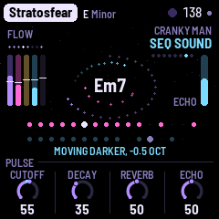
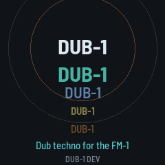
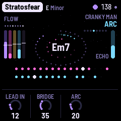
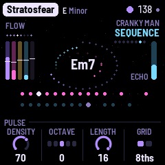
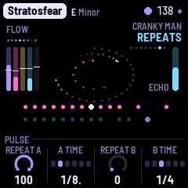
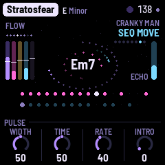
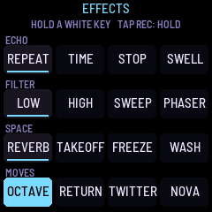
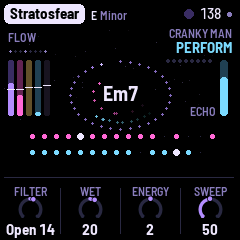

# NACHTFAHRT

NACHTFAHRT (called BERLIN while it was built) turns the M-VAVE FM-1 into a generative Berlin School
machine, after the 1970s music of Tangerine Dream, Klaus Schulze and Ashra: long, hypnotic pieces built on repeating synthesizer
sequences, slowly evolving textures and a lot of space. It plays itself from the moment it's switched on.
A sequence of plucked notes runs over a drone, its notes repeated by the echo; a second sequence, often a
step shorter, drifts against it; a lead sings long phrases far back in the reverb; wind, surf or the sounds
of space pass behind. Each piece opens from the drone, flows, gives the lead its turn, crosses a bridge, and goes on for ever;
every layer's filter moves slowly on its own. You don't play it, you steer it: pick a piece and a key, thin or fill the sequences, open the
filter, push the echo, mute and solo the layers, or play the lead yourself on the white keys.

Source, releases and the web installer: [github.com/FartyPants/fm1-nachtfahrt](https://github.com/FartyPants/fm1-nachtfahrt)
and [fartypants.github.io/fm1-nachtfahrt](https://fartypants.github.io/fm1-nachtfahrt/).

NACHTFAHRT is a fork of DUB-1, itself a fork of AMB-1, Charles Vestal's generative ambient firmware for the FM-1.

**This is 0.1, in development.** It runs in the browser emulator and the host simulator; it has not yet been
built for or run on an FM-1.

, running NACHTFAHRT, each control labelled")

---

## Contents

1. Install
2. Getting started
3. Controls
4. The screen
5. The layers
6. The arc and the filter motion
7. The pieces
8. The pages
9. The effects grid
10. PERFORM
11. MIDI
12. Saving
13. Troubleshooting
14. Credits

---

## 1. Install

**Try it first in the emulator.** It is the same code the FM-1 runs, with sound, in a browser. Build it
with `web/emu/build.sh`, serve `build/emu` (for example `python3 -m http.server --directory build/emu`) and
open the page. [EMULATOR.md](../EMULATOR.md) has the details.

**On the FM-1** (once there is a device build): `./build.sh` makes `build/amb.fwsc`; install it with

```
python3 tools/fm1_install.py build/amb.fwsc
```

(Python 3 with `pip3 install mido python-rtmidi`, the FM-1 connected by a USB data cable and switched on.)
Don't unplug it while it's writing; when it finishes, the FM-1 restarts into NACHTFAHRT. M-VAVE's own
updater, M-UPGRADE, puts the stock firmware back.

> Installing other firmware is at your own risk. If the FM-1 ever won't start, see
> [Recovering an FM-1 that won't start](#recovering-an-fm-1-that-wont-start).

---

## 2. Getting started

NACHTFAHRT starts playing as soon as it's on. A few minutes with it:

1. **Listen.** The first piece, Timewind (D minor, 96), begins with its drone, an organ through a
   phaser, and the wind. Its sequence is there from the start, behind a closed filter that opens over the
   first 32 bars (about 80 seconds). Then the sequence runs, its notes repeated by the echo, and later the
   lead comes in. Nothing is hidden: no layer is turned down behind your back, only filters move. Turn
   MASTER for the volume.
2. **Try another piece.** Turn PRESETS. Each of the eight has its own key, tempo, voices, sequences and
   arc. Stratosfear and Sunrain start at once with both sequences; in Wahnfried and Cyborg the
   Sequence is only a faint heartbeat under the drone.
3. **Play the lead.** Press a white key: the lead plays that step of the scale, from the root up, and its
   key lights while it sounds. It glides from note to note, deep in the reverb and the echo. The black keys stay lit: they play effects while you hold
   them, dark while held (Rise opens every filter, Close shuts them, and so on: see [The effects grid](#9-the-effects-grid)).
4. **Shape the sequence.** Press ARP: the Sequence page. KNOB 1 (Density) thins it out or fills it in;
   KNOB 3 (Length) makes it shorter or longer. Press ARP again for its sound (Cutoff opens the filter), and
   again for its **Repeats**: the notes the echo plays back, as loud as the note itself. One press more:
   its **Move** page, how its filter wanders around the Cutoff you set.
5. **Hold the echo.** Tap REC: the echo stops listening and repeats what it holds while the music goes
   on dry above it. Tap REC again to let it go. Hold REC: the effects grid, sixteen effects on the white
   keys, each one there while its key is held.
6. **Perform.** Tap SEL: white keys 1–5 mute the five layers, black keys 1–5 solo them, and white keys
   7–11, held, sweep the sequence, open or shut the filter, drop both sequences out or push the echo.
7. **Watch the filters.** On a layer's sound page, a small cyan dot on the brightness knob's ring shows where
   the filter is now, and the screen says how far it has moved ("MOVING DARKER, -1.5 OCT"). Turn the knob:
   the movement goes on around its new setting.
8. **Rest.** Press PLAY: the music stops and the echo and reverb ring away. PLAY again and the piece opens
   again from the top.

What you change is kept with the piece. NACHTFAHRT saves it by itself while resting; or hold GLO for half a
second.

---

## 3. Controls

| Control | What it does |
|---|---|
| MASTER | The volume |
| SELECT | On a layer's pages (the Drone, the Sequence, the Lead, Sequence 2, the Atmosphere, and each one's further pages), the layer's level, 1 a click: a ring in the middle of the screen shows it, and the header says it ("SEQ 64"). On the Nachtfahrt page it turns **Energy**, PERFORM's (the same value, 1 a click: the screen shows twice), so you can play the keys and push Energy at once: the knobs' rule shows "ENERGY 24" with a bar while you turn, and the header says it. Elsewhere it does nothing (the pages are on their buttons, the tempo on the Key page) |
| PRESETS | The piece (eight) |
| ALGORITHM | On a layer's page, its voice (on the Atmosphere's pages, its character). On the Chords page, the chord walk's character (Home, Wander, Free) |
| OCT− / OCT+ | On the Sequence's, the Lead's and Sequence 2's pages, the layer's octave, a step a press (the Sequence −2 to 2, the Lead and Sequence 2 −2 to 1): the page's Octave knob shows it, the header says it ("SEQ OCTAVE −1"). OCT+ is lit while that octave is above where the piece was loaded, OCT− while it's below. On the other pages they do nothing. Both held 5 s: the update mode |
| KNOB 1–4 | The four values at the bottom of the page. The line above them says what the one turning does |
| White keys | Play the Lead in the piece's scale: the first white key is the root, the next the scale's second step, and so on up. While the Lead sounds a note, that key is lit. On the Pattern page they write the steps instead; in PERFORM they mute and play moves; with REC held they're the effects |
| Black keys | Eleven effects, each while the key is held. They stay lit, so they stand apart from the Lead's white keys; a key goes dark while its effect is held: Take-off, Supernova, Twitter, Repeat, Swell, Freeze, Octave, Return, Rise, Close, Transpose (see [The effects grid](#9-the-effects-grid)). In PERFORM, the solos; on the Pattern page, the accents |
| PLAY | Play / rest |
| REC | A tap: hold (the echo and the cloud repeat what they hold). Held: the effects grid |
| EDIT | A tap: the Chords page. Held: the next chord, on the next bar. Held on (1.5 s): new chords |
| SEL | A tap: PERFORM. Held: **Lock** (the sequences stop varying, each pass as the last, until SEL is held again; not saved) |
| HOME | The Nachtfahrt page; again, the Key page |
| ENV | The Drone; again, its sound page; again, its Move page |
| ARP | The Sequence; again, its sound page; again, its Repeats; again, its Move page |
| LFO | The Lead; again, its sound page; again, its Move page |
| SEQ | Sequence 2; again, its sound page; again, the Pattern page; again, its Move page |
| SAVE | The Atmosphere; again, its sound page; again, its Move page |
| FX | The Space page; again, the Echo page |
| GLO | The Setup page; again, the Arc page (Lead in, Bridge, Arc). Held half a second: save. Held on (1.5 s): the piece back to its recipe |

**Nudges.** Hold a layer's button (ENV, ARP, LFO, SEQ) for half a second: its sound takes a small step
somewhere new (its filter, envelope, tone or vibrato, never its sends or octave). Hold it on for 1.5 s: a
shake, a new voice and bigger steps. HOME held on shakes every layer at once. Each step is pulled back
towards the piece's recipe, so nudges explore around the piece's sound rather than wander off. With Evolve
over 40, NACHTFAHRT nudges a layer by itself now and then.

A long press says what it did on a card in the middle of the screen.

---

## 4. The screen


The screen is black, with a few dim stars drifting slowly left while the music plays.

- **Top:** the piece, its key and mode, the tempo (EXT under MIDI clock). A dot means unsaved changes.
- **Top left:** the section of the arc (EMERGE, FLOW, SOLO, BRIDGE), with **hold** and **lock** after it in red
  while they're on, and under it the eight bars of the phrase.
- **Top right:** "CRANKY MAN", small, and under it the page's name (with SOLO beside it while a solo is on).
- **Left:** five **meters**, one for each layer in its own colour: the Drone (violet), the Sequence (pink), the
  Lead (gold), Sequence 2 (cyan), the Atmosphere (grey). Each rises with what its layer is playing. Across each
  one, a white **tick** shows where that layer's filter has moved to: above the middle, brighter; below,
  darker; six pixels for each octave.
- **Middle:** the chord the Drone plays, its name in white with nothing behind it. Each note of the
  Sequence sends a pink dot round it on the inner orbit, each note of Sequence 2 a cyan one on the outer
  orbit, fading over a few seconds; the echo's repeats are smaller, dimmer dots with a short trail. **Hold**
  turns the chord and the dots red and says "hold". A new chord comes in big and cyan for a moment.
- **The chord's ring:** round the orbits, a ring of violet dots shows how far the chord has gone: it grows
  clockwise from 12 o'clock, bar by bar, and is full when the chord changes, then starts again from 12. In the
  chord's last bar it is brighter, so you can play a phrase into the change. While held (REC) it stays as it
  is, in red; with Drift at Hold (the chord never changes) there is no ring.
- **Right:** the echo's level (ECHO).
- **A ring in the middle:** while you turn SELECT on a layer's page, its level as a big knob in its colour, the
  number inside and the layer's name under it (grey and MUTED if it's muted); it fades a moment after.
- **Below:** two **lanes**, the Sequence (pink) and Sequence 2 (cyan), each as long as its sequence: a big dot
  for each step that plays, a speck for a rest, and a white cursor on the step playing now. Two sequences of
  different lengths drift apart and meet again, and you can see them do it. On a layer's page, the other
  lane is greyed.
- **Bottom:** the page's four knobs and their values. While a knob turns, the rule above them says what it does;
  while SELECT turns Energy on the Nachtfahrt page, it shows "ENERGY", its value and a bar from the middle.

**The filter motion, shown.** On a layer's *sound* page (the one with its brightness knob), a small cyan
dot sits on that knob's ring where the filter really is now: the knob's own pointer stays where you set it.
Under the lanes the screen says how far it has moved: "MOVING DARKER, -1.5 OCT" or "MOVING BRIGHTER, +0.8 OCT"
(not shown while it is within a tenth of an octave of the knob). The screen reader says it too ("Cutoff
moving darker, about -1 octave").



**The launch screen.** Every time the FM-1 starts, NACHTFAHRT comes up large on black among a few stars, with
"by CRANKY MAN" under it and the version at the foot, for a moment. The music starts as always, under it.



---

## 5. The layers

**The Sequence** (ARP; MIDI channel 2) is the heart. Up to 16 steps in the scale, eighths or sixteenths,
played on a plucked voice: **2600** (a saw), **Moog** (two saws a little apart), **Synthi** (a square),
**Pulse** (a narrow pulse), **Glass** (an FM bell). Each goes through two low-passes, the second resonant,
swept down by a short envelope. The root step is accented and the others quieter (Accent, on the Pattern
page). Density decides how many of the steps sound, the least important dropping out first. Now and then
(Evolve, Motion) a step changes, a note moves, an octave jumps, the sequence comes round early; it follows the Drone's chord
(Transpose, on the Key page). Its cutoff wanders slowly over minutes, around the Cutoff you set (its Move page, below; its Width is the
**Sweep**, also on PERFORM).

**The Repeats** (ARP, third page) are what makes it Berlin: each note is played again at one of the echo's
times, by default a dotted eighth (**Repeat A**, as loud as the note: 100), and a second time
(**Repeat B**) into the rests only. They are real notes, so they go through the filter and the echo like the
rest, and the Sequences are sent into the echo generously. The echo's own time is by default a dotted
quarter (1/4.), so Repeat A, a dotted eighth, doesn't land on the echo's first repeat.

**Sequence 2** (SEQ; channel 4) is a second line, by default an octave down and a step shorter (7 against
8), so the two drift apart and come back together. It has the same voices and **Sub** (a sine and its
octave below). Chance thins it at random. Its **Intro** (Move page) opens its filter, from closed, over that many bars: in Rubycon
it comes out of the drone after the Sequence. Motion changes its steps and octave jumps but never its length:
an 8 against a 7 stays 8 against 7. And with **Motion**, at a change of section, Sequence 2 may move an octave up
or down from where its Octave knob is set (at the range's ends, the other way), and back at the next change of
section; never more than one octave away (the chance is Motion's: at 100 every time, at 0 never). Its page's
Octave knob shows where it is, and OCT+ or OCT− lights. Turn its Octave knob or press OCT− / OCT+ on its page and
what you set is its octave again, the move gone; what's saved is always the octave you set.

**The Drone** (ENV; channel 1) holds the chord on two banks of five voices: the chord's four notes and the
root an octave under (the **Pedal**). Voices: **Organ**, **Strings** (through an ensemble), **Choir**, **Saws**,
**Glass**. A phaser sweeps it slowly (**Phaser**). The chord walks from degree to degree every **Drift** bars
(the Nachtfahrt page), or follows the eight slots of the Chords page.

**The Lead** (LFO; channel 3) is one voice, gliding: **Odyssey**, **Mini**, **Flute**, **Theremin**, **Synthi**. It plays
phrases, long notes or a slow run ending long, starting on a chord tone, with a breath of bars between
(**Phrases**: how often). Its vibrato comes in late. By default its reverb and echo are at 90, so it sings far
away. It may start **Lead in** bars after the piece starts (the Arc page), plays now and then in Flow and fully in
Solo. Its filter's movement is kept gentle: never more than three quarters of an octave either way. The white keys play it too.

**The Atmosphere** (SAVE) is a background: **None**, **Wind** (a breath of noise through a narrow band, swept
slowly), **Surf** (waves), **Space** (chirps and bursts, far away), **Air**, or **Tape** (a crackle ringing on
the chord, DUB-1's).

---

## 6. The arc and the filter motion

A piece is not a loop: it goes through sections, chosen as it plays. But it never ends by itself: once it has
opened, it goes on through flow, solo and bridge for ever, until you stop it or change the piece.

### The filter motion

Nothing in NACHTFAHRT fades behind your back. A layer whose level is up and which isn't muted always plays at its
level (your mutes, your solos and PERFORM's Drop are the only ways a layer goes quiet, and they are shown).
What moves is each layer's **brightness**: the Drone's Colour, the Sequence's and Sequence 2's Cutoff, the
Lead's Tone and the Atmosphere's Colour. NACHTFAHRT moves each one's filter by an **offset in octaves from the
knob**, never to a value of its own. The knob keeps the value you gave it; turn it and the whole movement
moves with it at once.

Each layer has a **Move** page: ENV (the Drone), LFO (the Lead) or SAVE (the Atmosphere) pressed a third
time; ARP (the Sequence) or SEQ (Sequence 2) a fourth time. Its four knobs are the same on every layer:

| Knob | What it does |
|---|---|
| **Width** | How far the filter may move, either way: up to 2 octaves at 100 (the Lead: three quarters of an octave). 0: no wandering. On the Sequence's page this is the **Sweep** knob |
| **Time** | How long one move takes to arrive, eased: from about a bar to 32 bars (the Lead never under 4) |
| **Rate** | How often a new move starts: 100, about every 2 bars; 50, about every 11; lower, rarer; 0, never (the filter rests where its last move left it) |
| **Intro** | 0–64 bars. When the piece starts, the filter begins closed and opens over this many bars, slowly at first. 0: open from the start |

Each layer picks its own moves at random, so the layers diverge and converge: one getting darker while
another brightens. A new target near the knob's setting is a little likelier than one at the edge, so the
music comes back to the sound you set. The defaults are Width 20, Time 50, Rate 30, Intro 0; each piece sets
its own (see [The pieces](#7-the-pieces)). The clock is the transport's bars, so the motion stands still
while the music rests, and follows an external MIDI clock. The Atmosphere's colour is kept within about an
octave either way, whatever its Width.

The Intro happens once, when the piece starts (PLAY, or the piece changed or set back to its recipe). Turned up
while the piece plays, it waits for the next start (an open filter is never shut by it); turned down, the filter
opens sooner. A filter
at the start of its Intro is closed, so its layer is quiet for a while: the meter's tick sits low, the knob's
dot sits at the bottom, and the section reads EMERGE.

### The sections

- **Emerge:** the opening, for as long as the longest Intro is still opening. With every Intro at 0, a piece
  starts in Flow. It happens once and doesn't come back.
- **Flow:** the sequences; the Lead now and then.
- **Solo:** the Lead in full.
- **Bridge:** the sequences keep playing, but each layer's filter takes an extra move of its own, darker or
  brighter at random, of up to **Bridge**'s amount (the Arc page: up to 3 octaves at 100; the Lead's a third
  of that), eased in over the bridge's first four bars and out again over its last four. The layers part, and
  come together again at the end. Bridge 0: no extra move, and the section is like Flow. A swell of echo in
  the two bars before Flow returns.

Sections last 16 to 64 bars; **Motion** (the Nachtfahrt page) makes them shorter, and at 0 the piece stays in
Flow. At a change of section, with Motion, Sequence 2 may move an octave away for that section (see Sequence 2).

### The master actions move by themselves

With Motion, PERFORM's **Filter**, **Wet** and **Energy** move on their own, slowly, and their knobs show it
(the screen reader doesn't announce it):

- **Filter:** a slow swing between Shut 30 and Open 30, 64 bars round, opening first.
- **Wet:** from 0 up to +50 and back, 48 bars round.
- **Energy:** follows the arc: 0 at the start of the Sequence's slow rise, +50 at its peak, back down after
  (Arc 0: it stays at 0).

Motion sets how far: at 100 the full ranges above, at 50 half of them, at 0 none of them moves. Turn one of the
three knobs (or SELECT on the Nachtfahrt page, for Energy) and your value holds until the next change of
section; then the motion takes over again from your value, gliding back over eight bars, without a jump. Lock
holds all three where they are. A sequence whose level is 0 (Cyborg's Sequence 2) stays silent whatever
Energy does. A new piece, or PLAY from the top, starts the motion from its beginning.

### The Arc page

GLO twice. **Lead in** (0–64 bars): how long after the piece starts the Lead may play. **Bridge** (0–100): see
above. **Arc** (0–100): the length of the Sequence's slow rise: its filter climbs towards a peak (four fifths
of the way through) and settles, then does it again, for ever (0: no rise; 1–100: about 130 to 770 bars). The
fourth knob is empty.



The Sequence's offset is the sum of its wander, its Intro, the bridge's move and this rise; the black keys'
Rise and Close ([The effects grid](#9-the-effects-grid)) are one more term. The total is kept inside each
filter's usable range.

---

## 7. The pieces

| # | Piece | After | Key, tempo | Sequence | Drone, Lead | Atmosphere | Moves |
|---|---|---|---|---|---|---|---|
| 1 | **Timewind** | Schulze, *Bayreuth Return* | D minor, 96 | Two: 2600, 16 steps in 16ths, Repeat B; Sequence 2 Moog, 15 steps, an octave down; Reverb 50 | Organ + phaser, Odyssey | Wind | A slow opening: the Sequence's Intro is 32 bars. A gentle wander on every layer; Bridge 45 |
| 2 | **Wahnfried** | Schulze, *Wahnfried 1883* | B♭ Dorian, 80 | A faint heartbeat: the Sequence at 30 (opening over 16 bars), Sequence 2 at 50, an octave down | Strings at 95, the roots walking free; Theremin | None | The Drone's filter is the main movement: Width 45, with long moves; Bridge 30 |
| 3 | **Phaedra** | Tangerine Dream, *Phaedra* | D minor, 149 | Moog bass 16, a Moog line of 15 over it, much sweep | Choir, Flute | Tape | The Sequence opens over 16 bars (Sweep 85, wide); Sequence 2 straight in, sweeping often |
| 4 | **Rubycon** | Tangerine Dream, *Rubycon* | F minor, 144 | 2600 8, two octaves down, and Sub 7 at octave 0, dark | Organ, low and dark, Synthi | None | The Sequence opens over 16 bars, then Sequence 2 over 32: it comes out of the drone after it; Bridge 50 |
| 5 | **Stratosfear** | Tangerine Dream, *Stratosfear* | E minor, 138 | Pulse 16 and 2600 15, together from the start | Strings, Mini forward | None | Straight in, no Intros; both sequences' filters move often |
| 6 | **Sunrain** | Ashra, *New Age of Earth* | D major, 130 | Pulse 8, Glass 7, both repeats at 100 | Strings, Odyssey | Surf | Straight in, no Intros; Sequence 2 and the Atmosphere wander a little wider |
| 7 | **Mirage** | Schulze, *Mirage* | F♯ minor, 95 | Glass 12 and 11, sparse, in 16ths | Glass + deep phaser, Theremin; a long reverb | Space | A slow opening: the Sequence's Intro 16 bars, Sequence 2's 24; the Atmosphere moves widest |
| 8 | **Cyborg** | Schulze, *Cyborg* | C Phrygian, 70 | One, quiet (level 20): 2600, 8 steps in 8ths; no Sequence 2 | Organ, deep and beating; Theremin, low | None | The Drone's filter moves widely and slowly (Width 50, Time 70) |

In every piece the Lead's Width is low: it stays gentle. The names are working titles. The keys and tempos are
starting points from music analysis sites, to be tuned by ear; fast readings such as Phaedra's 149 and
Rubycon's 144 may be double the felt tempo (they run in eighths, which feel like sixteenths at half the speed).
NACHTFAHRT is not connected with any of these artists.

---

## 8. The pages

  

Each layer's pages share a layout: its main page has how much (K1), its octave (K2) and two of its own; its
sound page has brightness, envelope, Reverb and Echo (the layer's sends); its **Move** page has Width, Time,
Rate and Intro (see [The arc and the filter motion](#6-the-arc-and-the-filter-motion)).

**HOME: Nachtfahrt:** Filter (on everything, Off in the middle: turned down it shuts, a low-pass; turned up it
opens, a resonant high-pass), Evolve (how often the sequences change
a step), Motion (how much they change, and how quickly the sections move; 0: Flow for ever), Drift (bars
per chord: 2–64, or Hold).

**HOME again: Key:** Tempo (60–160), Root, Mode (Minor, Major, Dorian, Mixolydian, Pentatonic minor and
major, Phrygian, Lydian: the most common first), Transpose: how the sequences follow the chord. **Parallel**
moves the whole shape by the chord's interval, as an analog sequencer transposed by a keyboard (it may leave
the scale), **Diatonic** moves it by scale steps (it stays in the scale) and **Bed** doesn't move it (the
chord changes under it).

**ENV: Drone:** Pedal (the root an octave under), Reso, Phaser, Attack. **Its sound:** Colour (darker or
brighter, and the voices' detune), Release, Reverb, Echo. **Its Move page:** Width, Time, Rate, Intro.

**ARP: Sequence:** Density, Octave, Length (3–16), Grid (8ths or 16ths). **Its sound:** Cutoff, Decay,
Reverb, Echo. **Repeats:** Repeat A, A time, Repeat B, B time (1/8, dotted 1/8, 1/4, dotted 1/4, 1/2, a bar).
**Its Move page** (a fourth press): Width (this is Sweep), Time, Rate, Intro.

**LFO: Lead:** Phrases, Octave (−2 to +1), Glide (1–150 ms), Vibrato. **Its sound:** Tone, Attack, Reverb,
Echo. **Its Move page:** Width, Time, Rate, Intro (the tone's wander is kept gentle).

**SEQ: Sequence 2:** Chance, Octave, Length, Level. **Its sound:** Cutoff, Decay, Reverb, Echo. **SEQ a third
time: Pattern:** write the sequences yourself. KNOB 1 picks a lane: Steps (which of the Sequence's steps
play), Steps 2 (Sequence 2's), Octaves and Octaves 2 (which steps jump an octave), Skips (steps passed
over). The white keys are its sixteen steps. KNOB 2 is the Accent, KNOB 3 the lane's chance, KNOB 4 Play:
**Auto** (generated) or **Pattern** (as written). **SEQ a fourth time: its Move page** (Width, Time, Rate,
Intro).

**SAVE: Atmosphere:** Density, Width, Drift, Air; ALGORITHM its character. **Its sound:** Colour, Ring,
Reverb, Echo. **Its Move page:** Width, Time, Rate, Intro.

**FX: Space:** Echo (how much of everything goes into it), Echo time (a dotted quarter by default), Feedback
(the tail, in seconds), Reverb. The echo is a tape echo that ping-pongs left and right. **FX again: Echo:** Blur, Tone, Width, Size
(the plate).

**GLO: Setup:** Tune (±50 cents), MIDI out, Lights, Save. **GLO again: Arc:** Lead in, Bridge, Arc
(see [The arc and the filter motion](#6-the-arc-and-the-filter-motion)).

**EDIT: Chords:** eight slots. In **Endless** the walk writes them and slot 1 plays; on each change they move
up a slot. A key writes a slot's root, KNOB 2 its kind, KNOB 3 its type, KNOB 4 Play: Endless or **Loop**
(the slots in turn, nothing new). ALGORITHM sets the walk's character: Home, Wander, Free.

---

## 9. The effects grid



Hold REC: the grid fills the screen, four rows of four, one effect on each white key. An effect lasts while
its key is held; several can be held together. Let go of REC and the keys still held keep theirs until
they're let go.

| | | | | |
|---|---|---|---|---|
| **Echo** | Repeat: the Sequence thrown into the echo | Time: the echo's time doubled | Tape stop: the tape slowing to a quarter | Swell: everything into the echo |
| **Filter** | Low-pass: down to 350 Hz | High-pass: up to 1.3 kHz | Sweep: the Sequence's filter swept two octaves each way | Phaser: a deep phaser on all the music |
| **Space** | Reverb: the dry music into the plate | Take-off: a burst of noise falling into the echo | Freeze: the cloud holds what it has | Wash: everything into the echo and the plate, the dry down |
| **Moves** | Octave: the Sequence an octave up | Return: both sequences round their first four steps | Twitter: a burst of bleeps into the echo | Supernova: the echo's feedback past full |

### The black keys

In normal playing the black keys play effects too, each **while it is held** and lit, so one hand can play
the Lead on the white keys and the other the effects, with no REC needed. Left to right, the eleven black keys
are:

| Black key | Effect |
|---|---|
| 1 | **Take-off** (the grid's) |
| 2 | **Supernova** (the grid's) |
| 3 | **Twitter** (the grid's) |
| 4 | **Repeat** (the grid's: the Sequence thrown into the echo) |
| 5 | **Swell** (the grid's: everything into the echo) |
| 6 | **Freeze** (the grid's: the cloud holds) |
| 7 | **Octave** (the grid's: the Sequence an octave up) |
| 8 | **Return** (the grid's: both sequences round their first four steps) |
| 9 | **Rise:** every layer's filter opens together, up to 2 octaves, easing in over about a second and back over about three when you let go |
| 10 | **Close:** every layer's filter closes together, down 4 octaves, eased the same way: a breakdown played by hand |
| 11 | **Transpose:** both sequences three scale steps up (a fourth, in a seven-note scale) while held; the Drone's chord and the Lead stay |

The first eight are the grid's own effects, not copies: a black key and the grid's white key for the same
effect are one effect, on while either is held. Rise and Close are offsets from the knobs, like the filter
motion's, added to it (the Lead's stays within its three quarters of an octave); they never set a filter to
a value of their own. In PERFORM the black keys solo, and on the Pattern page they accent steps. The screen
reader names the effect as each key goes down.

---

## 10. PERFORM



Tap SEL. The knobs become the master actions: **Filter** (as on the Nachtfahrt page), **Wet** (the whole music dry, or drowned in the
echo: every layer's echo send, the Drone's, both Sequences', the Lead's and the Atmosphere's), **Energy**
(sparser or busier: the Sequence's Density, levels, Sweep, note length, Cutoff, and Repeat B, the second
repeat), and **Sweep** (how far the Sequence's cutoff wanders on its own: the same as its Width on the
Move page, the piece's). With Motion, Filter, Wet and Energy also move by themselves, the knobs showing where
they are; a turn of yours holds until the next section ([The master actions move by
themselves](#the-master-actions-move-by-themselves)). The keys
that do something are lit:

- **White 1–5:** the Drone, the Sequence, the Lead, Sequence 2, the Atmosphere, muted and back (their levels
  kept). A mute is complete: a muted Lead lets go of its note at once (and plays nothing from the white keys),
  a muted Drone is silent, and neither sends MIDI notes while muted.
- **Black 1–5:** the same, soloed (more than one: they play together). (In normal playing, the black keys
  play effects instead: [The black keys](#the-black-keys).)
- **White 6, held:** the knobs become the levels (Drone, Seq, Lead, Seq 2).
- **White 7–11, held:** **Sweep** (the Sequence's filter swept), **Open**, **Shut** (the filter pushed),
  **Drop** (both sequences out), **Echo** (the echo pushed, everything in and feeding back).

SEL again, or a page's button, leaves.

---

## 11. MIDI

MIDI comes in over USB and the TRS jack, and goes out over USB.

- **Out** (on by default; a muted layer sends nothing): the Drone on channel 1, the Sequence (and its repeats) on 2, the Lead on 3,
  Sequence 2 on 4, and, on its own tempo, clock with start and stop.
- **In, clock:** the sequences follow MIDI clock, and start, continue and stop start, continue and stop
  the music. The screen shows EXT for the tempo; when the clock stops, NACHTFAHRT goes back to its own.
- **In, channel 1:** a note adds or removes its note from the scale ("ADDED", "REMOVED"; the root stays,
  three notes at least). The keys no longer do this; they play the Lead.

### Screen reader

NACHTFAHRT can tell the [FM-1 Screen Reader](https://charlesvestal.github.io/fm1-reader/) what its screen
shows, over USB: the page and its knobs, a knob's value as it turns, the piece, its key and tempo, the
chord as it moves, the effects as they're held, and every message. Press W in the reader to hear the whole
screen again, with the section of the arc and its bar, and how far a filter has moved. The FM-1 says nothing until the page connects.

---

## 12. Saving

NACHTFAHRT keeps all eight pieces in the FM-1's memory, each as you left it, with Tune, MIDI out and Lights.

- **By itself:** a few seconds after a change, while resting (writing to the memory interrupts the sound
  for a moment, so it never happens while the music plays). A dot at the top means unsaved changes.
- **GLO held** half a second: saves now ("SAVED").
- **Setup's KNOB 4 (Save):** shows Save while there are unsaved changes, Saved once there aren't; a turn
  saves.
- **GLO held on** (1.5 s): the piece back to its recipe ("RESET"); not saved until the next save.

Lock and PERFORM's Filter, Wet and Energy aren't saved; a piece change (or GLO's reset) returns the three to 0, so
none of one piece's push carries into the next. Projects saved by DUB-1, AMB-1 or an earlier NACHTFAHRT
build aren't read: NACHTFAHRT starts with its eight recipes.

---

## 13. Troubleshooting

**Update mode:** hold OCT− and OCT+ together for five seconds. A countdown appears; let go before it ends to
cancel.

**Calibration:** if a button or knob does the wrong thing, hold OCT− and OCT+ while you switch the FM-1 on.
The screen asks you to press each button and turn each knob in turn.

**After a crash:** NACHTFAHRT shows a red CRASH screen and restarts by itself. The next start shows RESTARTED
AFTER A CRASH and an address (PC ...) for a moment; if you report the problem, include it and what you were
doing.

**Safe mode:** if NACHTFAHRT crashes twice in a row while starting, it starts in SAFE MODE: no sound, but USB
works, so you can reinstall with `tools/fm1_install.py` or put the stock firmware back with M-UPGRADE. Press
PLAY to try starting NACHTFAHRT normally. If even safe mode fails twice, the FM-1 drops into the chip's own
update mode, and only the rescue below can reach it.

### Recovering an FM-1 that won't start

An FM-1 in the chip's own update mode shows a blank screen, and neither the installer nor M-VAVE's updater
can see it. On a Mac, in a checkout of the source, run:

```
bash tools/fm1_rescue.sh
```

Install the command line developer tools if asked, type your Mac password if asked, then plug the FM-1 in
and switch it on when the script says it's waiting. It checks the chip, saves a backup of the FM-1's memory
in `fm1-rescue` in your home folder, and asks before it writes. Type **yes**; don't unplug anything until
it says it's restarting the FM-1, which then starts into its original firmware. The script downloads its
rescue tool from X0X's repository, M-VAVE's FM-1 V15 firmware and JieLi's flash loader, checks the firmware
against a known fingerprint, and writes only the firmware area, never the bootloader or the FM-1's own
settings. If the FM-1 never shows up at all, Felucca's
[FM-1-transporter](https://github.com/kurogedelic/FM-1-transporter) can still reach it.

---

## 14. Credits

Source, releases and the web installer: [github.com/FartyPants/fm1-nachtfahrt](https://github.com/FartyPants/fm1-nachtfahrt)
and [fartypants.github.io/fm1-nachtfahrt](https://fartypants.github.io/fm1-nachtfahrt/).

NACHTFAHRT is free software under the GNU General Public License, version 3. If you share the firmware, you
must also share its source code.

- NACHTFAHRT is a fork of [DUB-1](https://github.com/sbegueria/fm1-dub), a fork of
  [AMB-1](https://github.com/charlesvestal/fm1-amb) by Charles Vestal (GPL-3.0-only), whose echo chain,
  plate, pieces system, chord walk, UI and platform it keeps.
- The music is Tangerine Dream's, Klaus Schulze's and Ashra's of the 1970s, as heard; nothing of theirs is
  in it.
- The way the sequence is played (a short pluck, the root accented, sparse notes, a dotted-eighth repeat as
  loud as the note, two delays filling the spaces) owes much to Synth Seeker's videos on Berlin School
  sequencing.
- The reverb is Jon Dattorro's plate ("Effect Design, Part 1", JAES 1997), by way of
  [FoMni-1](https://github.com/charlesvestal/fm1-fomni).
- The granular cloud (Freeze) follows the design of CLOUD in [JIANT](https://github.com/juanjiant-bit/JIANT)
  (GPL-3.0), another FM-1 firmware.
- The Tape atmosphere is DUB-1's crackle, after Bahadirhan Kocer's "Using Resonators in Live".
- The chord walk is a weighted random walk over the scale's degrees, from AMB-1's `chord_change`.
- The platform (hardware layer, USB, update loader, installer and storage) is from **Felucca** by Leo
  Kuroshita, Hügelton Instruments, by way of [X0X](https://github.com/charlesvestal/fm1-x0x), FoMni-1,
  AMB-1 and DUB-1.
- The idea of running FM-1 firmware in the browser comes from [Groove OS](https://www.groove-os.com/).
- The fonts are Barlow Semi Condensed and Terminus (SIL Open Font License).

M-VAVE and FM-1 are trademarks of their owners. NACHTFAHRT is not connected with M-VAVE or Hügelton Instruments.
